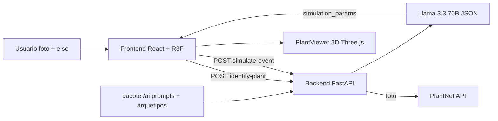

<p align="center">
  <a href="https://github.com/anomalyco/opencode"></a>
</p>

<p align="center">
  
  
  
  
</p>

<p align="center">
  <b>Ferramenta educativa que mostra em texto + modelo 3D o que aconteceria com uma planta ao sofrer um fenomeno qualquer.</b><br/>
  <i>Ex.: "e se eu jogar 12 litros de agua de uma vez no manjericao?" vai dar explicacao biologica + planta 3D murchando e amarelando ao longo dos dias.</i>
</p>

## Indice

- [Sobre](#sobre)
- [Como funciona](#como-funciona)
- [Tecnologias](#tecnologias)
- [Estrutura do projeto](#estrutura-do-projeto)
- [Roadmap](#roadmap)
- [Protocolo de casos extremos](#protocolo-de-casos-extremos)
- [Como rodar](#como-rodar)
- [Variaveis de ambiente](#variaveis-de-ambiente)
- [Como testar o parcial do Passo 1](#como-testar-o-parcial-do-passo-1)
- [Equipe](#equipe)
- [Aviso educativo](#aviso-educativo)
- [Licenca](#licenca)

## Sobre

O PlantLab 3D resolve o medo de errar cuidando de plantas. Em vez de manual chato de botanica, o usuario:

1. Identifica a planta (foto ou nome digitado)
2. Descreve um "e se..." em texto livre ("7 dias sem luz?", "12L de agua de uma vez?")
3. Recebe explicacao biologica gerada por LLM (Llama 3.3 70B)
4. Ve um modelo 3D reagindo (murcha, muda de cor, cresce/encolhe, alerta de estresse)
5. Arrasta uma linha do tempo (dia 0 ate dia N) e compara dois cenarios lado a lado

Projeto de feira agora, produto de verdade depois.

## Como funciona



Exemplo: foto de manjericao vira `Ocimum basilicum` (confianca 0.92, arquetipo `folha_larga`); "12 litros de agua" vira explicacao PT-BR + `{wilt: 0.3, cor: amarelado, crescimento: -0.2, stress: true, dias: 7}`; o modelo `folha_larga.glb` murcha 30%, amarela e mostra alerta.

## Tecnologias

<p align="center">
  <a href="https://skillicons.dev"></a>
</p>

<p align="center">
  
  
  
  
  
  
  
  
  
</p>

| Camada | Stack | Papel |
|--------|-------|-------|
| `frontend/` | React + Vite + TS, react-three-fiber + drei, recharts | UI + cena 3D + timeline + comparacao A/B |
| `backend/` | FastAPI + uvicorn, httpx, python-multipart, python-dotenv, pytest | Endpoints `/identify-plant` + `/simulate-event`, CORS, rate-limit futuro |
| `ai/` | Prompts versionados, mapa especie-arquetipo, testes de prompt | Cerebro biologico, importado pelo backend a partir do Passo 5/6 |

## Estrutura do projeto

Sempre mantemos as 3 pastas raiz: `frontend`, `backend`, `ai`.

```text
PlantLab/
├── README.md
├── LICENSE
├── .gitignore
├── frontend/                  # React + Vite + TS (Passo 1: tela padrao Vite)
│   ├── src/ (App.tsx, main.tsx)
│   ├── public/models/         # .glb por arquetipo (chega no Passo 9)
│   └── package.json
├── backend/                   # FastAPI (Passo 3: /health + stubs mockados)
│   ├── main.py
│   ├── requirements.txt
│   ├── tests/test_endpoints.py  # pytest: 10 testes (sucesso + 400)
│   └── .env.example
└── ai/                        # Pacote IA separado
    ├── __init__.py
    ├── archetypes.py          # ARCHETYPE_VALUES + normalize_archetype()
    └── prompts/
        ├── simulate_event.md
        └── protocolo_casos_extremos.md  # Protocolo E-01 (casos extremos)
```

## Roadmap

### SPRINT 1 — Fundacao

- [x] **Passo 1 — Setup do monorepo** (Vite react-ts + FastAPI /health + README como rodar)
- [x] **Passo 2 — Layout base** (header, upload com preview, textarea e se, botao Simular, placeholder resultado)
- [x] **Passo 3 — Endpoints stub** (`POST /identify-plant` + `POST /simulate-event` mock + pytest 10/10)
- [x] **Passo 4 — Conectar front e back (mock)** (identificar + simular reais, loading, erro amigavel)

### SPRINT 2 — Inteligencia real

- [ ] **Passo 5 — PlantNet real** (foto vira especie + confianca + arquetipo)
- [ ] **Passo 6 — Llama 3.3 70B real** (evento livre vira `{explanation, simulation_params}` JSON estrito, inclui Protocolo E-01)
- [ ] **Passo 7 — Refino fluxo real** (loading longo, confianca < 0.5, erros traduzidos)

### SPRINT 3 — O modelo 3D

- [ ] **Passo 8 — R3F + placeholder** (`<PlantViewer/>` com luz + OrbitControls)
- [ ] **Passo 9 — .glb reais** (`useGLTF` por arquetipo em `public/models/`)
- [ ] **Passo 10 — Animar pela simulacao** (murcha, cor, escala, stress com `useFrame`, inclui animacoes do Protocolo E-01)

### SPRINT 4 — Timeline, comparacao e polish

- [ ] **Passo 11 — Timeline** (slider dia 0-N com interpolacao)
- [ ] **Passo 12 — Comparacao A/B** (2 viewers + grafico recharts)
- [ ] **Passo 13 — Polish feira** (banner educativo, loading unico, Nova simulacao, mobile)

### FASE 2 — Pos-feira

- [ ] ESP32 + sensores (umidade, temp, luz) e digital twin real x simulado

## Protocolo de casos extremos

**Protocolo E-01 — todo "e se..." merece resposta a altura.** O usuario nem sempre esta
brincando, e mesmo quando esta, a resposta certa educa sem moralismo.

1. **Levar a serio:** responder o cenario de forma literal — o que aconteceria de verdade
   com a planta (ex.: jogada no rio, jogada no sol extremo).
2. **Sem recusa e sem sermao:** explicar as consequencias fisicas e biologicas de forma
   direta, educativa e com leveza.
3. **Animacao dedicada quando viavel:** mapear o evento para uma animacao especifica do
   modelo 3D (ex.: submersao e arrasto no rio; ressecamento e queimadura no sol) +
   explicacao correspondente.
4. **Fallback honesto:** sem animacao especifica, usar estresse generico no nivel maximo
   coerente + explicacao cobrindo o cenario.
5. **Seguranca e ambiente:** se houver risco a pessoas, animais ou ao ambiente (ex.:
   planta toxica em rio), incluir aviso breve. Informar, nunca incentivar.

Detalhe operacional em `ai/prompts/protocolo_casos_extremos.md` (16 casos em 5 grupos:
agua e liquidos, temperatura extrema, quimica domestica, fisica e mecanica, ambiente —
ex.: mar, agua fervendo, fogo, freezer, agua sanitaria, oleo, micro-ondas, queda,
escuro total). Executado no
**Passo 6** (LLM trata extremos sem recusa) e no **Passo 10** (mapa evento-animacao
especial + fallback), com casos de grupos distintos em cada bateria de testes.

## Como rodar

Dois terminais separados.

**Terminal 1 — Backend (http://localhost:8000):**

```bash
cd backend
pip install -r requirements.txt
python -m uvicorn main:app --reload
```

Docs: http://localhost:8000/docs | Health: http://localhost:8000/health

**Terminal 2 — Frontend (http://localhost:5173):**

```bash
cd frontend
npm install
npm run dev
```

Nota Windows: se o PowerShell bloquear `npm` com erro de ExecutionPolicy, rode uma vez como Admin `Set-ExecutionPolicy -Scope CurrentUser RemoteSigned`, ou use `cmd /c "npm run dev"`.

## Variaveis de ambiente

Copie `backend/.env.example` para `backend/.env` (nunca commite o `.env`):

```env
PLANTNET_API_KEY=
LLM_PROVIDER=groq
LLM_MODEL=llama-3.3-70b-versatile
LLM_API_KEY=
```

| Chave | Onde conseguir | Quando precisa |
|-------|----------------|----------------|
| `PLANTNET_API_KEY` | my.plantnet.org (conta gratuita) | Passo 5 em diante |
| `LLM_API_KEY` | provedor do Llama 3.3 70B (Groq, Together, OpenRouter ou HF) | Passo 6 em diante |

Ate o Passo 4 nenhuma chave e necessaria (usamos mocks).

## Como testar o parcial do Passo 1

1. Suba o backend: `cd backend` + `python -m uvicorn main:app --reload`, abra http://localhost:8000/health e confira `{"status":"ok"}`; abra http://localhost:8000/docs e veja `GET /health` e `GET /` listados.
2. Suba o frontend: `cd frontend` + `npm run dev`, abra http://localhost:5173 e confira a tela padrao do Vite + React + TS sem erro no console (F12).
3. Teste de queda: derrube o backend (Ctrl+C) e recarregue o `/docs` para ver erro de conexao esperado; o frontend deve continuar abrindo normalmente isolado.
4. Teste rapido por codigo: `npm run build` no frontend passa (tsc + vite); `TestClient(app).get("/health")` no backend retorna 200.

Tudo isso foi executado aqui e passou: TestClient 200 `{"status":"ok"}`, CORS liberado para localhost:5173, uvicorn live 200, vite dev live 200, `npm run build` em 613ms sem erro.

## Equipe

Bryan Moreira, Leonardo Alves, Renan Mobrise, Gabriel Rossi, Luis Pedro, Keliyah Cristine.

## Aviso educativo

> PlantLab 3D e uma ferramenta educativa. As simulacoes sao aproximacoes baseadas em IA e nao substituem experimentos reais nem recomendacoes agronomicas profissionais.

## Licenca

MIT — veja [LICENSE](LICENSE).


<p align="center">
  
</p>
